# Articles

Copies of my articles whose original pages are offline. Bnieuws (the TU Delft architecture faculty magazine) no longer has a working website, so these were recovered from the [Wayback Machine](https://web.archive.org/). Each one is also on the site under [archive/](archive/).

## Contents

- [Dreamed Cities as Neurodivergent Cities](#dreamed-cities-as-neurodivergent-cities)
- [The Future of Home](#the-future-of-home)
- [Cheap Absurdity](#cheap-absurdity)
- [Collective Trauma - War and Humour](#collective-trauma-war-and-humour)
- [A Short Story of Bnieuws](#a-short-story-of-bnieuws)
- [50 Euros for the Pleasures. Sex Workers in Red-Light Districts](#sex-workers-in-red-light-districts)
- [Taboo in translation](#taboo-in-translation)
- [The History of Human-Computer Interaction](#the-history-of-human-computer-interaction)
- [The Adolescence and Architecture](#12-20childhood-pdf)
- [A Union of Architects: Team 10, Modernism and Capitalism](#11-20union-pdf)

---

### Dreamed Cities as Neurodivergent Cities

Oct 2022 · in *Dreamscapes*

Original: <https://www.bnieuws.nl/read/dreamed-cities-as-neurodivergent-cities>  
Archived copy: <https://web.archive.org/web/20241102204911/https://www.bnieuws.nl/read/dreamed-cities-as-neurodivergent-cities> (2024-11-02)  
On this site: [archive/dreamed-cities-as-neurodivergent-cities/](archive/dreamed-cities-as-neurodivergent-cities/)

###### From the editors

###### Oliwia Jackowska

What does the notion of DREAMED SPACES strike you as? Maybe you think liveability, large green spaces and walkable cities... or, maybe like me, you see them as personal interpretations of places around us which show themselves as visions while we sleep. These live between the deepest subconscious layers of our minds. What do they mean? Why should we watch them a bit closer?

[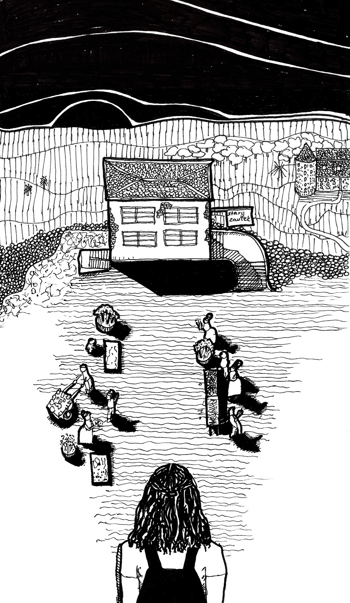](https://web.archive.org/web/2023/https://www.bnieuws.nl/read/dreamed-cities-as-neurodivergent-cities#)

Impression of a dream.

At some point in life, I am sure, most people try to seek the meaning of their dreams. It could be when going through puberty, as an attempt to understand own desires, or maybe a bit later on, fascination with dreams becomes a way to cope with anxiety triggered by a burnout or heartbreak. In attempts to interpret these often entangled and seemingly nonsensical imaginative worlds, we search for symbolisms. And even though we lose interest eventually, as it might seem to be just an empty fascination leading nowhere, the scholars have been trying to understand dreams for centuries and use them in psychological diagnosis and therapy. The key figure in dream studies was Carl Jung, who, nowadays, however much criticised for his approach, saw dreams as *psyche*’s attempt to communicate crucial things to the individual. He explored the idea of *the collective unconscious*, being a set of “default” mental concepts that are at the base of society and include instincts and archetypes that are inherent to being a human. With these two notions considered, by and large, Jung was interested in using his patients' dreams to map out the relationship of their*psyche* to this wider context of *the collective unconscious*, hence understanding what is an individual's position to or within that universe of societal ideas.

This fascinating theme keeps circling back to myself as well, despite me being no expert in psychology. The idea of one’s *psyche* standing, for example, in contrast to what is generally considered as the instinctive default, shows that everyone’s relation to the world around them, as they see and experience it in *the waking reality*, is extremely personal and it manifests in its true form through their *dreams*. These dreams always occur in some kind of time, space and emotional state, and, however much abstracted the image is, our minds draw inspiration from the reality. In relation to that, an interesting concept was described by scholar Athanasios Totlis for North American Journal of Medical Sciences. Developed as*Spatio-Temporal and Emotional* (ST+E) dream theory. It analyses and defines the relation in all the three listed aspects between *dream representations* and *the waking reality*: Space, Time and Emotion. On a side note: sounds familiar to tools used for site analysis in design projects, right? Interestingly, in architectural or urban spatio-temporal analysis there is no inclusion of the aspect of emotion, while it proves over and over to be one of the most important elements of building an individual’s relationship to a place. Now, we can say that in dreams, generally, it happens that (as seen in the graph with three theoretical elements):

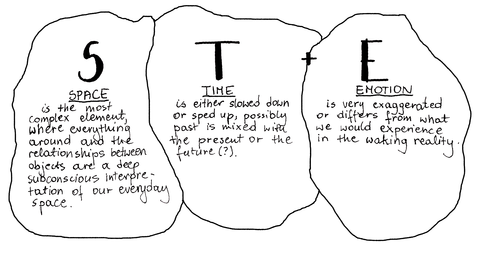

Let's focus on the aspect of *space*, which without a doubt is the most complex component. By paying closer attention to our *psyche*, which is by far better informed than our conscious way of thinking, we can learn about our real desires, needs and, most importantly, the relationship to the spaces around us *in the waking reality*. Now, let me take you through my own personal experience with dreams as there is no other way to showcase this theory rather than being very specific... So here on consider yourself welcome to see a sector of my own *psyche*.

In everyday life, I get lost easily and lose track of the space around me, unless it is a route deeply engraved in my day to day routine (even this requires high alert attention). You will always find me walking through places with my eyes pinned to the maps on my phone screen, and following closely the dot with the little direction arrow, as more often than not I am not able to position myself. *This shop here is on the other side, but which side of that shop am I supposed to turn by and… what is the name of the street?* Not sure how to say it else, but really, it is a problem, and has always been, however much I tried to concentrate and just do better. Even, or rather should I say - especially, my hometown, in which I grew up in and visit often, cannot be navigated without that wonder of digital live mapping. But what might surprise you, this off-track condition disappears, and I am never disoriented about my whereabouts when they are placed within my *dreams*. Truly, as if "Inception" was real, I am, in concrete detail, understanding and have unconscious control over the spaces around me, which often have very specific features, placed in cities that make sense.

Though, even when I am dreaming about my hometown, the places in it seem familiar but they are in completely different configurations - their relationships to each other are redefined and shuffled to match my own *psyche*. My brain re-designs the city so that when I am in control, it is custom-made just for me and... it works. Suddenly I don't get lost, I know where to go, even though in dreams the purpose of the trip might not be so clear. You can say that*dreamed cities* are *neurodivergent cities*, where the importance and meaning of places (or rather the associated Emotions) are the uttermost quality, while the form or function does not matter almost at all.

In one such dream, I was moving through my hometown, but the most important street of the old town was wider and longer than normally and was leading through shops and gathered street vendors, who with their clothing seemed to be taken out of the Positivism era. I moved towards a hill, which in reality is a smooth and rather small incline, but here the hill was beautiful, and I could see the landscape and the sunset behind a house positioned at the highest point. The house was my destination in this dream, which *in the waking reality* is an obscure building hidden away, but one that has been, since forever, a meeting spot for me and my best friends.

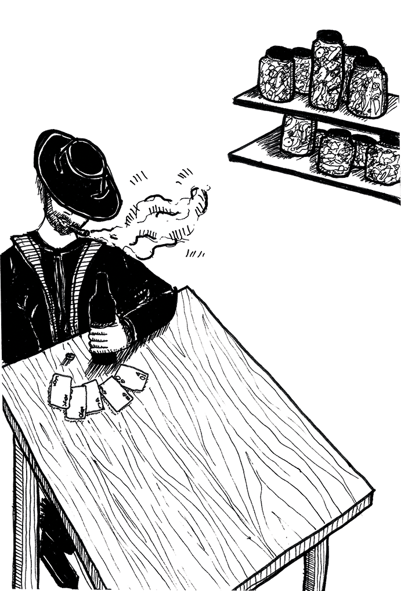

*Impression of a dream*

In a different dream, I was walking through a city, the city that is actually located on Mars, but with its long streets of repetitive houses it was reminiscent of my university town of Bath in England. Though, the red ground of the other-worldly planet made it seem as if a town straight from a western movie, just as did the murky and dark interiors of the pubs occupied by cowboys and countless jars filled with unidentified contents. Easy to say: I did not enjoy my time in England. But what is even more important about these short stories is that when the *image of the city* is filtered only through our own imagination in a way completely devoid of conscious bias, it changes the way we read the space. The places of importance are connected in a peculiar way to each other in dreams, and hence they are not *geographic anymore*, but *spiritual* or *mental interpretations*. This way we can ask, what are the limitations of this? If we pay attention to the our dreams and those of others, can we understand not only our own relationship to Jung's *collective unconscious*, but also the way we rationally understand cities and spaces? Have we been doing it wrong this whole time? Does everyone have their own interpretation of the space, or do they overlap somewhere to create*familiar archetypes*? There are limitations, of course, as much as you can analyse your own dreams overlapping different *psyches* might prove way too complex with no limits to human subconscious imagination.

Despite this complexity, I believe there is value in linking the dream theory into our analysis of cities and diving deeper into an idea of why some (or maybe most?) people do not seem to fit in. Getting lost just might be a symptom of a bigger problem.

A German filmmaker, Hito Steyerl, in her article "In Free Fall: A Thought Experiment on Vertical Perspective", refers to the present moment as *distinguished by a prevailing condition of groundlessness*. She argues that due to that lack of stable ground, with nothing under our feet, we are in a constant state of free-falling, without noticing. This comes with a sense of disorientation, since the horizon is no longer a constant linear point of reference. Paradoxically, by *falling* *asleep* we enter the state of lightness, and just like with falling, we lose any sense of where our body begins and the world ends. I believe that*falling asleep* is the true meaning of Steyerl's *falling in place*. Hence, the value that I have found in my own journey is a gentler view of my spatial disorientation, as I realised that it is not me getting lost in the waking reality's surroundings, but the surroundings losing me.

This article is a thought experiment and it attempts to spark some processes and discussions. Please share your own thoughts or dreams with us, on instargram @bnieuws or via email bnieuws@tudelft.nl.

[Return to top ↑](https://web.archive.org/web/2023/https://www.bnieuws.nl/read/dreamed-cities-as-neurodivergent-cities#top)

---

### The Future of Home

May 2022 · in *Onbekend Maakt Onbemind*

Original: <https://www.bnieuws.nl/read/the-future-of-home>  
Archived copy: <https://web.archive.org/web/20241102205559/https://www.bnieuws.nl/read/the-future-of-home> (2024-11-02)  
On this site: [archive/the-future-of-home/](archive/the-future-of-home/)

###### From the editors

###### Oliwia Jackowska

A few months ago, three students, Saif Ragaei, Ammar Yasser and Mariam Ihab, interviewed by KooZA/rch, realised “how unstable the notion of normal life is by examining the situations where this sense of normalcy is destroyed in a horrific suddenness.” They questioned the fragility of our day to day in the face of political conflict and natural disasters and for the theme of the future of home they sent their contribution of technical drawings of destruction.

[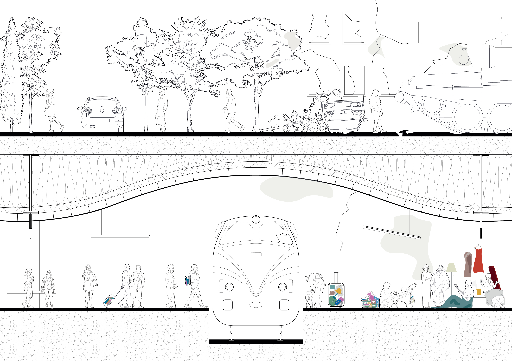](https://web.archive.org/web/2023/https://www.bnieuws.nl/read/the-future-of-home#)

Illustration by Oliwia Jackowska. Click to look closer!

This bleak and dreary way of looking at the future, as seen by these three students, might have been still interpreted by some as overly dramatic and unnecessarily pessimistic about two or three months ago. In the end, the resourcefulness of Dutch technology as well as the innovative mindset our university works in solutions and has left no space for despair. Even the grimiest of scenarios are approached with an attitude full of action and feedback loops.

However, since the first day of the Russian invasion of Ukraine, the world, and especially our world of imaginative and very European academia, was shocked. It has been hard to accept for many, the uselessness of our field. How is this possible? They told us that we can save the world with architecture, and that urbanism can reshape our futures! It is uplifting to imagine a scenario where all are equal, no prejudice exists and we can all commute through a tube directly connected to our living rooms. *But where in this discussion about the future do we include the people whose lives have been ripped apart?*, asked Saif, Ammar and Mariam. Where are the people whose reality changed drastically and the effects of their trauma are about to continue to manifest over generations? A skewed and unintentionally ignorant point of view comes from lack of understanding what these exciting and utopian-like notions really entail. It comes from lack of empathy.

Ultimately, there are situations where no explanation, no plan and no solution can be found. Most extensive horrific acts in the recent decades have been happening at a safe distance from the European every-day and the reality of the "Western World", even though it seemed that peace was hanging on by a thread. But the sanctity of Home has been violated for many, and the images that come from the Ukrainian land leave us feeling robbed of our own humanity. And yet for us, here, they are still just images.

Destruction driven by sadistic cruelty and vague imperialistic nightmares ravages the walls of homes, and with the walls everything sacred falls brutally. Those who have the means, family and friends abroad or simply nothing else left to loose, flee their country, their life, and the remains of their homes. With all kinds of pets carried under their arms and hastily decided priorities in the suitcase these brave people march forward ready to build their sacred everything back again, even if wrecked in this new reality. Everything else is gone. The favourite chair fell broken and covered in the ashes that are left from the missiles hitting the floor slab. The bathtub, once an object of warmth and relief is now exposed to the street covered in broken pieces. And the TV, a source of entertainment and hope, shines its shattered screen, its wounded surface, to the sky with all the visions of prospect stubbornly silent.

Then, is the point of this article to raise awareness, to start innovating ideas with these complexities in mind? On the contrary, it is simply a plea for empathy, even a passive one, as without it there is no future of home, no future at all really. Empathy for what we do not know and do not understand, so that we can try to love, comprehend and validate experiences that are unimaginable. Sometimes, the transition from here to there is just as simple as recognising our own objects in those displaced far away from the sanctity of home.

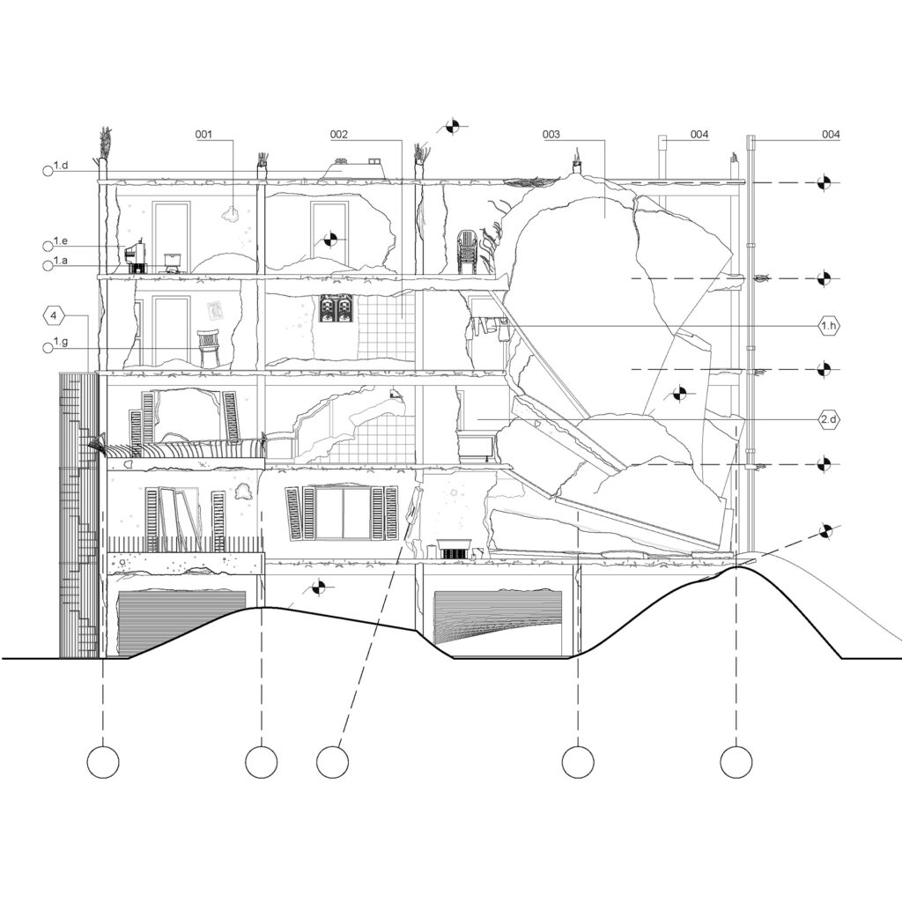

*Competition entry for the future of Home by Saif Ragaei, Ammar Yasser, Mariam Ihab. (KooZA/rch)*

In Netherlands you can support the Ukrainian people in need for example by donating goods, money or time to Students For Ukraine. @studentsforukraine_

‍

[Return to top ↑](https://web.archive.org/web/2023/https://www.bnieuws.nl/read/the-future-of-home#top)

---

### Cheap Absurdity

Dec 2021 · in *Cheap*

Original: <https://www.bnieuws.nl/read/cheap-absurdity>  
Archived copy: <https://web.archive.org/web/20250908114341/https://www.bnieuws.nl/read/cheap-absurdity> (2025-09-08)  
On this site: [archive/cheap-absurdity/](archive/cheap-absurdity/)

“You’re tearing me apart, Lisa!” is a quote which is nothing short of iconic. The delivery of the line and the senseless surrounding storyline of *The Room* makes for the absurdity of what is happening on-screen. *The Room*, *Birdemic: Shock and Terror* and virtually anything by Neil Breen are films that are just bad, yet something still draws us to watch and cherish the moments of these disastrous flops.

‍

[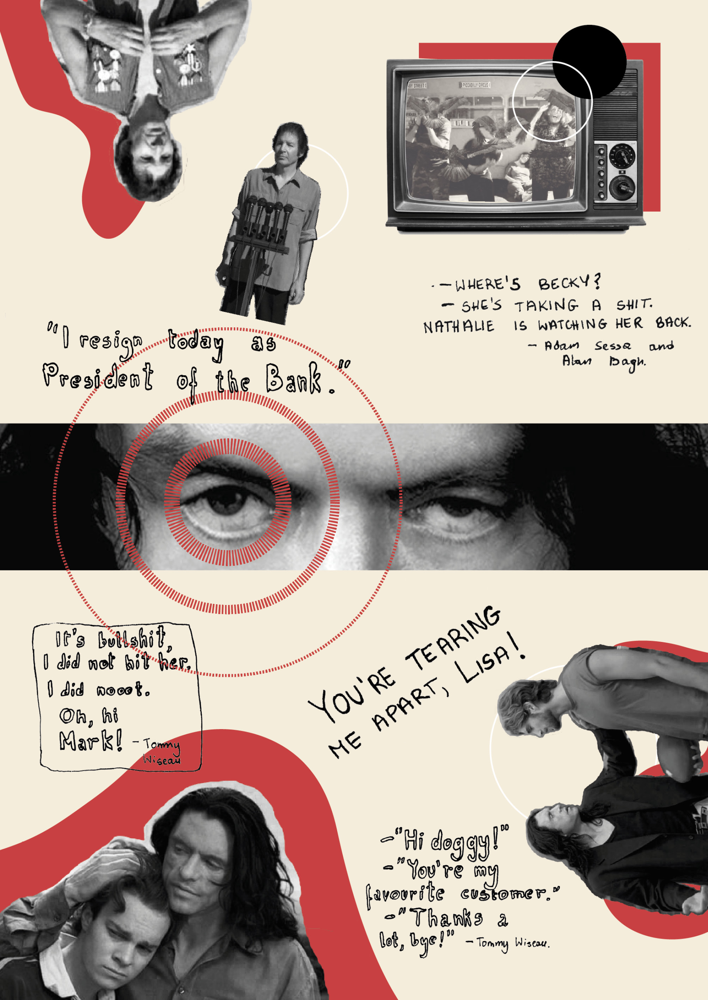](https://web.archive.org/web/2023/https://www.bnieuws.nl/read/cheap-absurdity#)

The mishmash of cheap absurdity.

The enigmatic persona of Tommy Wiseau and the making of the worst movie ever made was attempted to be explored (and monetised on) in James Franco’s *The Disaster Artist*. This kind of elevation of failure to the status of art could be seen as pretentious, but it also tells us something about ourselves.

We create relationships with the spaces of our home, office, school, shop or… rooftop and understand how we position ourselves within them. But when this relationship, both with space and reality in general is translated into a two-dimensional storyline by somebody who has not understood the art of filmmaking, something amazing happens. Everything is twisted, turned upside down, and most of all seems like an absurd fever-dream. But this absurdity in cheap understanding of space brings something more, it brings the simple honesty that we long for. *The Room* ‘s budget was Wiseau’s self-raised 6 million US dollars, which covered the set, actors, equipment and obviously the enormous number of takes, as the creator could not be satisfied with his own performance. The low budget does not mean that the film is doomed to be bad, considering that around the same time, the beloved*Little Miss Sunshine* was made for 8 million US dollars, and a legendary Brazilian masterpiece *City of God* was completed with only 3.3 million. Low budget is one thing, but the amateur way of translating space into a moving picture, presented two-dimensionally provides the viewers with honesty that is rare to find. Even though *The Room* has a very simple concept and the set, as suggested in the title, is a limited space itself, the shots are confusing, and the movements and dialogues abstract in the weirdest of ways.

Inevitably, these kinds of works are born from the lack of self-realisation and seeing oneself as a genius beyond the currently understood borders. The 2010*Birdemic*, for instance, warns us about the effects of climate change and we could argue that these days, it is more relevant than ever. Neil Breen, the undignified master of green screen, tells us about the threats of government corruption, and provides us with unforgettable performances. As a result, the commerce, the iconic value and status that follow these films proves that they bring a certain prowess.

Does it tell us something more about the cinema or the human understanding of space in general? Now, with the world becoming full of amateur filmmakers, new ways are emerging, and they are changing the way we think about spaces, images of it and our own presence within it. To enter other people’s heads and visions without the army of producers, set designers and consultants presents the vision as being pure and raw, straight from the conscience of the ‘genius’ mind. We all want to be like them. To do our thing against all odds.

---

### Collective Trauma - War and Humour

Oct 2021 · in *Humour*

Original: <https://www.bnieuws.nl/read/collective-trauma-war-and-humour>  
Archived copy: <https://web.archive.org/web/20250908125719/https://www.bnieuws.nl/read/collective-trauma-war-and-humour> (2025-09-08)  
On this site: [archive/collective-trauma-war-and-humour/](archive/collective-trauma-war-and-humour/)

It was April 4th 1960. The realm of the Polish cinematic art scene became divided in how to represent the nation’s painful recent history. In the aftermath of unmeasurable destruction and hardship as Poland became Europe’s battlefield, the filmmakers faced challenges in preserving the memory of suffering and reflecting the moods of their society.

[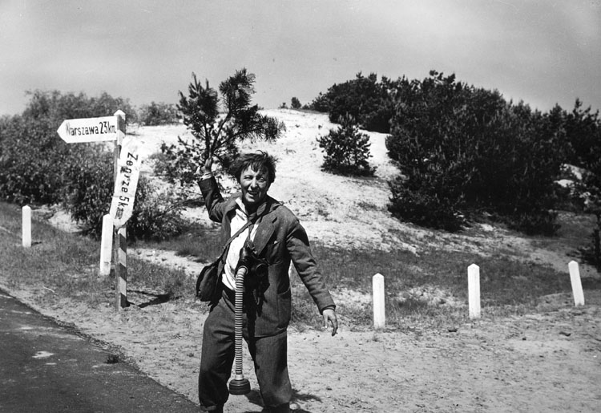](https://web.archive.org/web/2023/https://www.bnieuws.nl/read/collective-trauma-war-and-humour#)

A still from Bad Luck (Polish: “Zezowate szczescie”), 1960. Jan Piszczyk in Struga.

Just fifteen years after the end of World War II, and at the time of the current socialistic regime, Andrzej Munk and Jerzy Stefan Stawinski made a first film that comically presented the Polish martyred history. It was the main character who made this film so hilarious. Clumsy, unsuccessfully conformist, but most of all unlucky Jan Piszczek goes through different periods of his life, which spread through the 1930s, the war period and the post-war aftermath. Thrown into situations he did not ask for, he is a complete mess and failure, nothing goes as he would like to. Critics were polarised by either praising this new approach to writing history or found the production to be disrespectful. The film was criticised for presenting “a hero of our tragic history, but at the same time a villain ridiculing that same history”, while on the other hand it was praised for its realistic approach to every day people.

Dark humour and using a joke as a release of painful emotion has been explored in popular culture and academia for quite some time. Many well-known (American) comedians have been dealing with their traumatic past, like Pete Davidson, or struggled with exclusion and bullying in their childhood, like Sarah Silverman or Dave Chapelle. Their satirical approach often served as a coping mechanism to these experiences. Making jokes about trauma has always been a delicate issue, as there are many undefined boundaries when dealing with personal traumatic experiences. However, the definition and treatment of trauma changes in the context of collective memory, as it is shared and therefore less defined and personal. This shared experience gives nations, cities, ethnic minorities, genders or even families a new identity of which the sentiment is only fully understood within these groups. Humour in these situations provides a release, something that is shared collectively and gives this identity a new, lighter layer of understanding. It also opens up this hermetic sentiment to be understood by the “outsiders”.

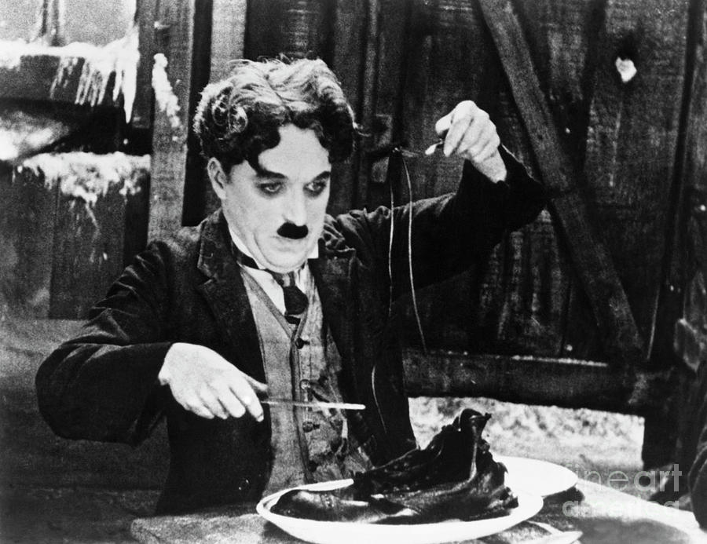

*A still from The Gold Rush, 1925. Chaplin's boot as a meal.*

Andrzej Munk’s film Bad Luck ("Zezowate Szczescie") was praised for its referential nature when it comes to the classics of Charlie Chaplin’s slapstick comedies. The grand-master’s influence on the cinematic field is undeniable. Chaplin often provided this humorous release much needed in the period of silent cinema ravaged by conflict, hunger and poverty. However, what made his approach to comedy special is that humour is often self-referential and he did not try to create a new reality, where the trauma ceases to exist. The 1925 silent movie The Gold Rush talked about a period that has seen many lives lost, and was very real to the people who watched it. The iconic sequence of Chaplin preparing and eating his own boot is funny and ridiculous, as it juxtaposes the absurdity of the character’s exaggerated table manners with the tragic desperation of hunger.

Arguably, the most quintessential film ever made by Chaplin is The Great Dictator released in 1940, right in the midst of the ongoing global war. This film’s satirical portrayal of Adolf Hitler aimed to ridicule the reasoning, sanity and real influence of this small man. Its seemingly light-hearted storyline culminated in the emotional and poignant speech of Adenoid Hynkel (Chaplin’s parody character of Adolf Hitler), where he realises his shortcomings and asserts he does not wish to rule or conquer anyone. Hynkel ultimately wants peace on Earth, as for him the unity of humans is the most important value. Chaplin’s film addressed the ongoing horror of the real war, as he ridiculed the figure that was most feared in the world at the time, and urged the people responsible for the conflicts to come to their senses.

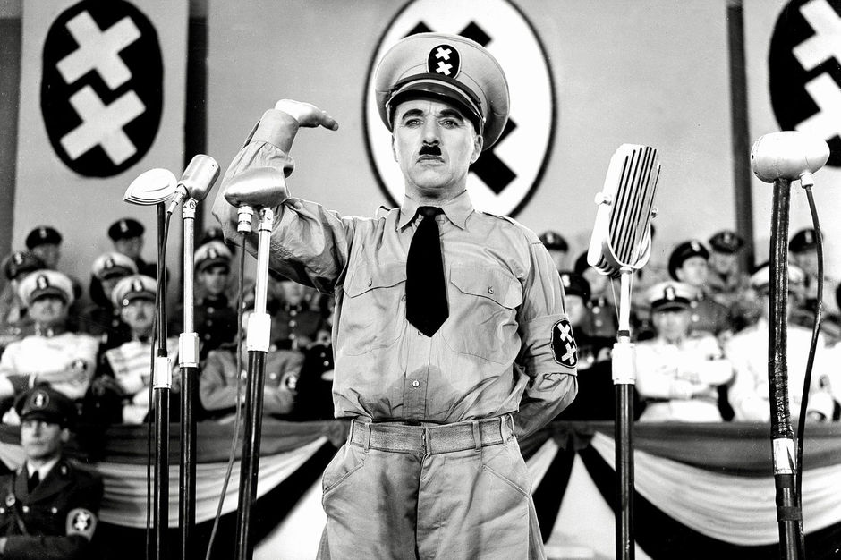

*A still from The Great Dictator, 1940. Hynkel's speech.*

The collective memory of trauma is not always catalysed directly by a human factor. Many nations and communities share their memories of destruction and loss in the events of natural disasters, unexplained events. However, the theme of war and conflict always involves a human error that can be ridiculed, a misunderstanding or just generally abstract ideals that people end up sacrificing everything for. This seems to be the reason why the only satirical art, films or writings about collective trauma revolve around war, political, social, ideological or economic conflict. Already in 1905, Freud talked about the cathartic function of a joke. Nonetheless, portraying traumatic historical events in a funny way has always been a delicate issue. The emotional confusion linked with war comedies can be understood as offensive (usually when executed badly), but also it allows the artists to be more realistic in commemorating the events. Following the controversial success of Bad Luck, the first part of How I Unleashed World War II (Polish: “Jak rozpętałem drugą wojnę światową”) was released in 1969. The comically unfolding events convince the main character Franciszek Dolas in believing that his thoughtless actions are the sole reason for the outbreak of the war. Dolas, being inherently a good person, tries to rehabilitate his mistakes and when escaping the Gestapo, he is thrown around by fate into different war situations in Yugoslavia, Mediterranean region, Africa and then back to Poland. This film was released long enough after the war and provided a witty Polish soldier character for it to become iconic. The film is renowned for one of the funniest scenes in Polish cinema, where asked for his name by Nazi soldiers, Dolas cleverly replies: “Grzegorz Brzęczyszczykiewicz, born in Chrząszczyżewoszyce”.

> **“Humour heightens our sense of survival, and preserves our sanity.”**

Even though it seems that nowadays all “Western” nations live in relative peace, exporting their conflicts to distant regions and communities, there is still an ongoing idealogical war that occupies the territory of Europe and America. The issue of bombings and ISIS terrorist attacks, and the aftermath of 9/11 was addressed beautifully through humour in the 2010 British film titled Four Lions. The film protagonists are five British Muslim men, who are plotting a bombing, but cannot agree about what the target should be. Omar is deeply critical of Western society, but his cousin Waj is dim-witted, convert Barry is bad-tempered, and Faisal is naïve, while later recruited Hassan does not seem to understand the weight of the situation. We find all of them involved in terrorist activity, and it is irrelevant how they got into it and why. Their clumsy and uncalculated actions result in accidental assassination of Osama bin Laden, discussions about blowing up the pharmacy chain Boots and making compilations of silly “bloopers” of their threatening recordings. Here, the protagonists are villains, but they are also clueless and this makes the viewer root for them to survive. Riz Ahmed, the lead in the movie, said in the interview that at first when seeing the proposed the script he was reluctant to play another “brown terrorist”, but what convinced him about the importance of the project was the film’s objective to humanize the characters in post 2005 London bombings reality. The ridicule, the tragic story set in the British suburbs, the compassion for the characters and the institutional racism all create a story that is compelling, funny and most of all, incredibly relevant. It rewrites history and loosens up the rigid perspective of the suffering.

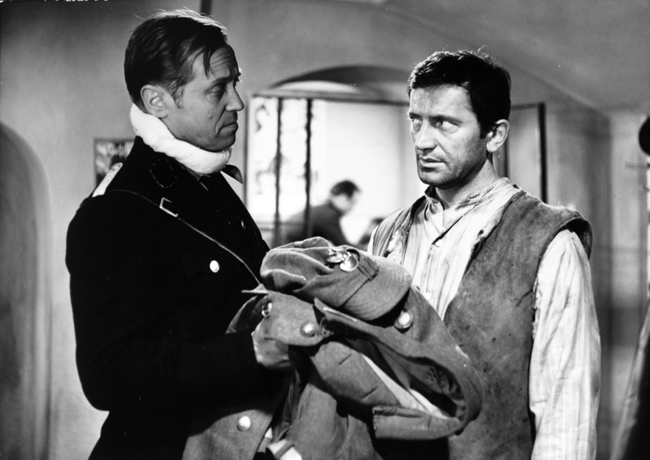

*A still from How I Unleashed World War II, 1969. Franek Dolas and a Nazi officer.*

These films show that dark humour, even collective, is a very personal issue, it depends on the nation, the severity and reasons for the conflict. But in all cases, the humour providing playful accounts of the past and of identities, softens the blow of the horrendous events of which the portrayed group can be either a victim or a perpetrator. Eyal Zandberg wrote in his text, Ketchup is the Auschwitz of Tomatoes, that the Holocaust being satirically portrayed in history was an “evolutionary development: from the use of humour to criticise Holocaust remembrance to the use of Holocaust memory to create humorous effects”. This is exactly how Charlie Chaplin used humour to ridicule and criticise the politics of his time that were causing the conflict to spread around the globe and resulted in the deaths of countless people and cities. Then, these destroyed cities and communities affected by the aftermath, used the history of their tragedy to create humorous effects and commemorate their suffering.

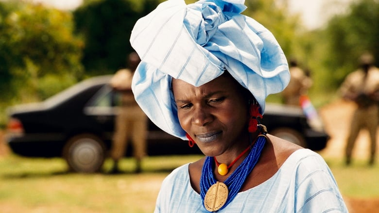

*A still from Night of Truth, 2004*

This also makes the phenomenon of war and its satire universal and understandable by everybody. Fanta Régina Nacro, a director of the 2004 Burkina Faso film Night of Truth (French: "La Nuit de la Verité") took that concept of universal war as the starting point. Watching from afar the horrors of the Yugoslavian war, she created a story about the fragility of peace, set in a fictional West-African country. Even though the comedic element exists in the story through the character of the village idiot, the humour does not play a central role as in the other mentioned films. Nacro argues that the universality of war comes from the suffering of loss and uncertainty of tomorrow, and she proved that a person or a nation does not need to live through a war to understand it.

This article opens a discussion about collective trauma in different cultures and communities. Apart from the films that were made by generations still affected directly by the aftermath of their wars, there are also modern humorous portrayals of the Holocaust, such as widely acclaimed Jojo Rabbit. Its impulse to bring history as a modern cautionary tale, rather than commemorating the events of the past, gives yet another perspective. However, this English-language-centric distribution of media, and consequently film, creates an imbalance in understanding of the other perspectives in this matter. More or less satirical approaches to war in their regions such as the 1996 Croatian film How the War Started on My Island or the 2008 Afghan Opium War get lost in the dominated “Western” perspective. What are artistic expressions in your region that cope with trauma satirically and with the use of humour?

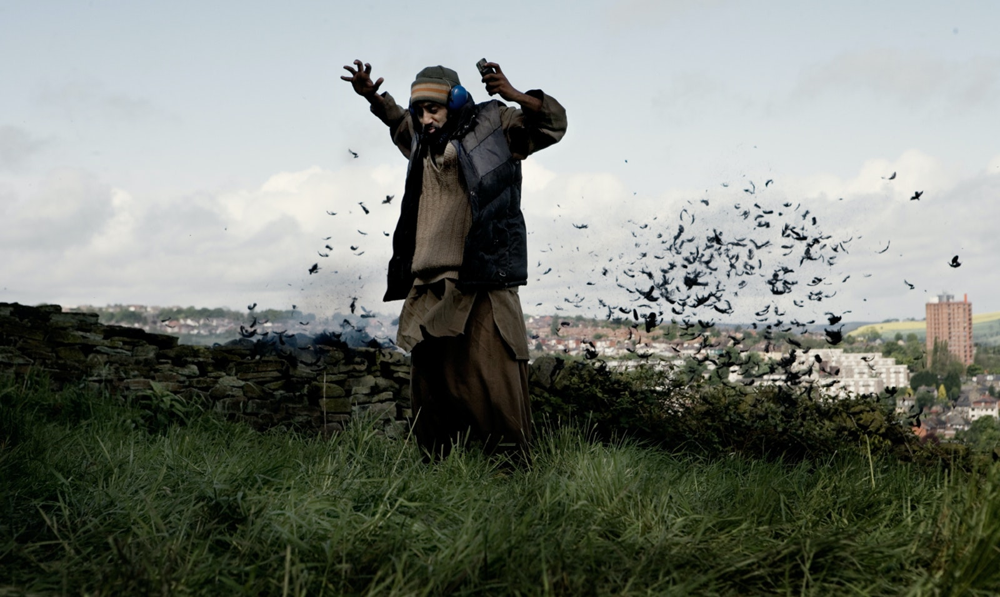

*A still from Four Lions, 2010. Faisal is testing crows' skills as bombers.*

---

### A Short Story of Bnieuws

Jun 2021 · in *Optimism Pessimism*

Original: <https://www.bnieuws.nl/read/a-short-story-of-bnieuws>  
Archived copy: <https://web.archive.org/web/20250908130344/https://www.bnieuws.nl/read/a-short-story-of-bnieuws> (2025-09-08)  
On this site: [archive/a-short-story-of-bnieuws/](archive/a-short-story-of-bnieuws/)

[The Competition is out now!](https://web.archive.org/web/2023/https://www.bnieuws.nl)[*Become a Pen Pal!*](https://web.archive.org/web/2023/https://www.bnieuws.nl/contact#penpals)

!

###### From the editors

###### Oliwia Jackowska

Find out about the behind the scenes of the Bnieuws editorial team, who find themselves in a strange situation and need to find a way out.

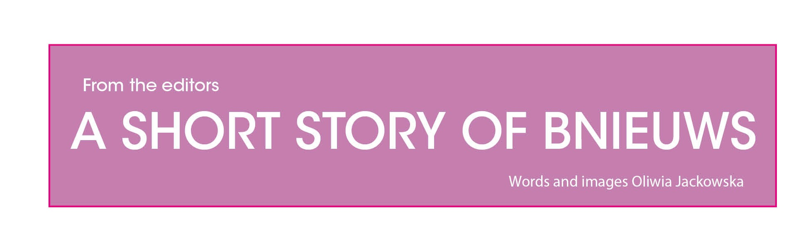

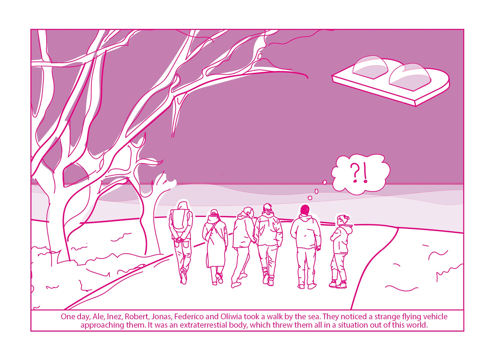

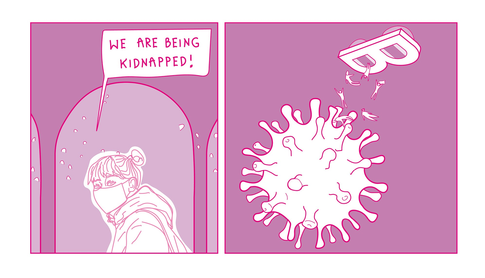

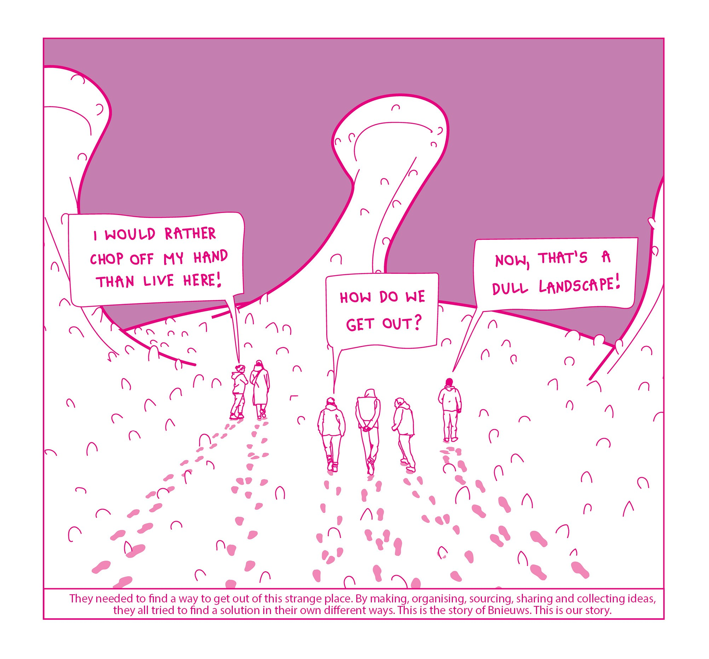

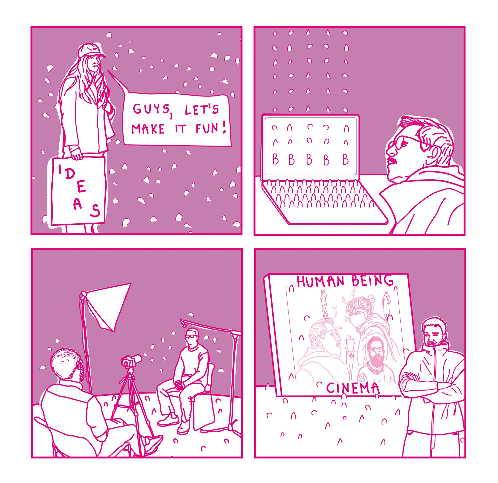

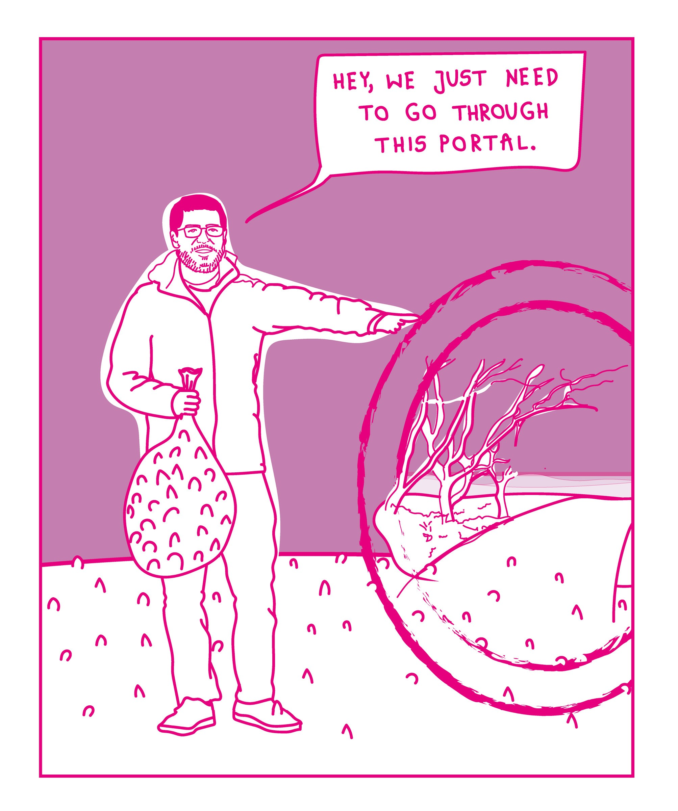

[Return to top ↑](https://web.archive.org/web/2023/https://www.bnieuws.nl/read/a-short-story-of-bnieuws#top)

[A Recap of INDESEM.21](https://web.archive.org/web/2023/https://www.bnieuws.nl/read/a-recap-of-indesem-21)

[Read →](https://web.archive.org/web/2023/https://www.bnieuws.nl/read/a-recap-of-indesem-21)

10

[Local Liability](https://web.archive.org/web/2023/https://www.bnieuws.nl/read/local-liability)

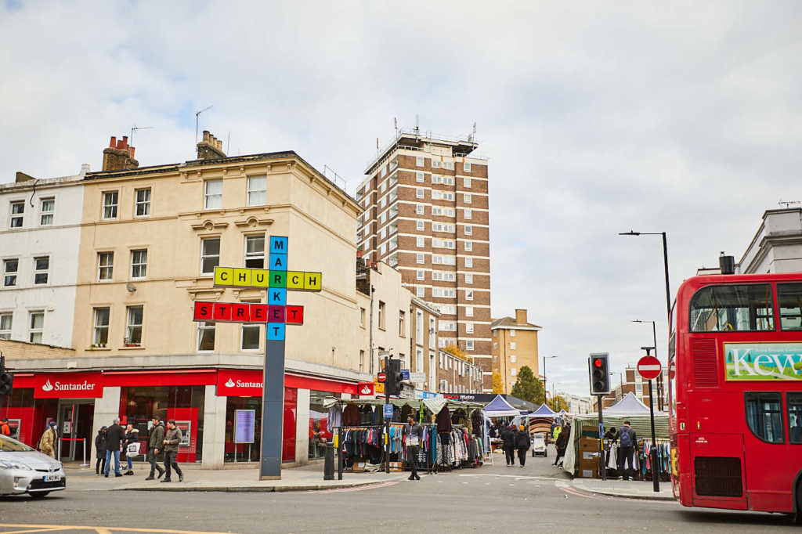

[Read →](https://web.archive.org/web/2023/https://www.bnieuws.nl/read/local-liability)

1

[The INDESEM Archive](https://web.archive.org/web/2023/https://www.bnieuws.nl/read/the-indesem-archive)

[Read →](https://web.archive.org/web/2023/https://www.bnieuws.nl/read/the-indesem-archive)

2

---

### 50 Euros for the Pleasures. Sex Workers in Red-Light Districts

May 2021 · in *Colours*

Original: <https://favas.net/reports/sex-workers-in-red-light-districts/>  
Archived copy: <https://favas.net/reports/sex-workers-in-red-light-districts/> (live page)  
On this site: [archive/sex-workers-in-red-light-districts/](archive/sex-workers-in-red-light-districts/)

#### **Sex Workers in Red Light Districts**

###### **50 Euros for the Pleasures**

**Oliwia Jackowska** reports for Favas.net on ensuring the safety and independence of sex workers. And why red light districts? According Jackowska prostitution and sex services have always been lining the urban fabric around the world. Sex work has been dubbed the oldest profession in history. Her article explores the contradicting ideas on sex work and why we should be talking about it.

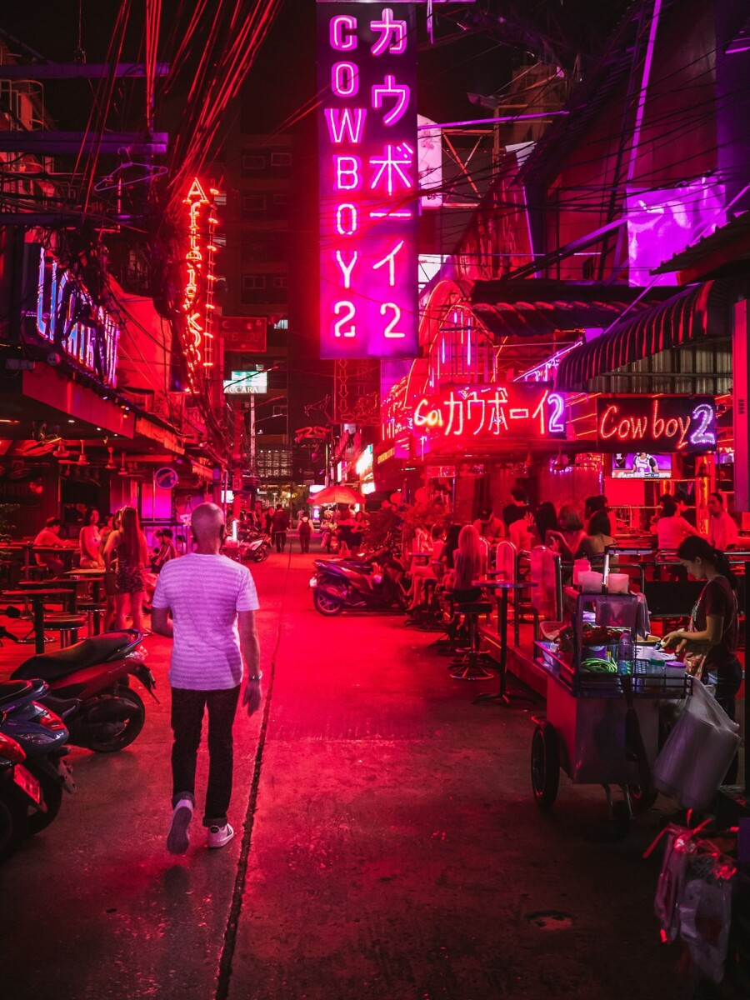

*Red light area around Soi Cowboy, Bangkok (Thailand). Image by Pablo Torrado.*

In a political discussion about women’s rights in Poland, after a nearly total abortion ban in the country, I was told that *“if a man loses his job, he becomes homeless; a woman always has the option to sell sex, and the strong market demand for their services makes women privileged”*. This, quite frankly, ridiculous comment inspired me to explore why still mostly women find work in prostitution, and what role does this play in the protection of women’s rights? There are very few topics that spark such polarised responses either in academic studies, public opinion or political actions. Many different actors involved in the discussions are biased and present contradicting images of reality. Even the relevant data is often unverifiable. The stigmatisation of prostitution makes it impossible to resolve the core problems – ensuring the safety and independence of sex workers.

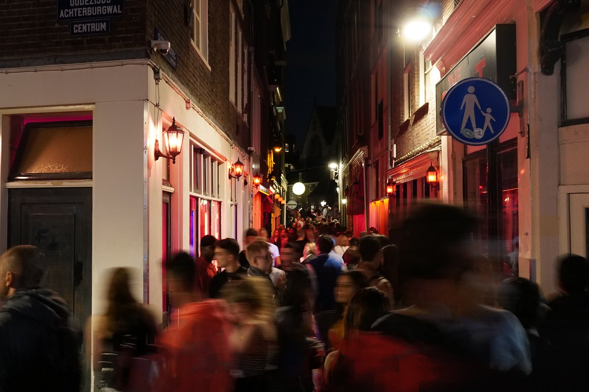

*Alley in De Wallen, Amsterdam (Netherlands). Image by Gio Mikava.*

The red light district in Amsterdam is a popular tourist destination, and I have walked through it whenever visiting the city. Other red light districts are scattered around the world, with some of the most known located in Thailand. The combination of the legality and regulation of prostitution in these districts, is one of the two approaches debated by the EU parliament in tackling the illegal sexual activities and human trafficking. The other one is described as abolitionist – the supporters of which argue that human trafficking and prostitution are interlinked and sex work should be completely de-legalised (European Commission, 2016). However forward-thinking and liberating the legalisation of prostitution might seem though, there are a lot of issues that you don’t see at first glance.

First of all, creating red light districts in the city and confining public sex activity to one area does not serve the celebration of sexuality, but rather, in the eyes of city planners, it limits the dirt within the boundaries of its district. This ensures better spatial control over the activities. You could argue that it helps the police to protect the safety of the workers, but it also greatly reduces the opportunities for services to be performed on the sex worker’s own terms. Confinement to bars, clubs or rooms located in a specific area increases the competition for space and limits the creative control over their activity. According to an article by Humanity in Action, it costs around 90 to 150 Euros to rent a room for an eight-hour shift, which means that sex workers in Amsterdam’s red light district need at least four to five clients per day in order to be able to pay the rent (Cruz and van Iterson, 2021).

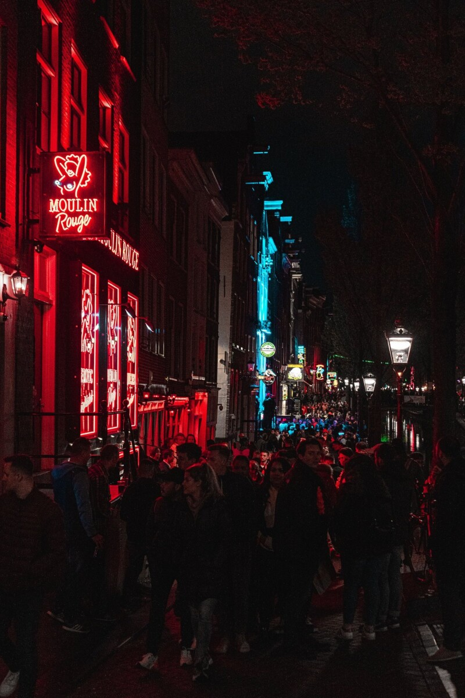

*Sex services in De Wallen, Amsterdam (Netherlands). Image by Joan Oger.*

*“It’s kind of like window shopping for clothes, but with girls inside.”* (Belingar, 2016). This is how a blogger described his experience of *“fulfilling a lifelong dream”* and paying for sex services in Amsterdam. Personally, I fail to believe that women in shop-fronts, displayed like any other advertised product represents the real image of freedom and female sexual liberation?

Another problem faced by sex workers in the Netherlands is the lack of identity protection. To run their business legally, which involves employing a pimp and paying the rent, they need to register with the government. However, it is unclear what the data from registration is used for and who has access to it. With the stigmatisation of prostitution in society, the access to such data by potential future employers could limit the sex workers’ options for an alternative career (Cruz and van Iterson, 2021). This lack of anonymity, combined with high costs of running a business legally, and competition for spaces makes more and more sex workers risk their personal safety and choose the illegal path instead.

With everything considered, Amsterdam still represents a good step towards tackling sexual exploitation in a reasonable way. In most of the world, street workers are just part of the urban reality, and considered a taboo, their safety is rarely discussed. The subject of prostitution and sexual exploitation is extremely gendered, and still needs to be addressed as a protection of women’s rights. You could argue that men can also be sex workers, and their rights need to be addressed as well. However, to truly tackle these problems the underlying bias and general context needs to be better uncovered. The EU reports on human trafficking in 2016 show that 77% of registered victims in EU (excluding UK data) were female, and 95% of all people trafficked specifically for sexual exploitation were women and girls. Men constitute the majority of victims trafficked for labour exploitation.

According to some literature, women entering prostitution are often linked to vulnerability, homelessness and limited access to legal employment due to discrimination. Linked to this data, most of the EU member states, feminist groups and politicians advocate for abolition of prostitution. They recognise that such activity often puts women in high risks of physical and psychological harm, and even risks of death. In contrast to that, the sex worker and human rights organizations have repeatedly advocated for decriminalization of prostitution. When all forms of prostitution are illegal, the sex workers are far more reluctant to report abuse or other under-age workers as they fear being arrested as well. This affects the actual safety of women, and makes human trafficking even more difficult to uncover (Schulze et al., 2014).

I find this lack of consensus on the basic principles, the biggest challenge for the future of sex workers. There are some examples that show the dissonance between these realities. The EU parliament shares that 89% of sex workers have no other possibility for economic survival, even though they wish to escape prostitution. However, as pointed out by Maggie McNeill, a retired call girl now turned writer, many of these reports are distorted due to the fact that woen interviewed are usually found in jail or drug addiction facilities (Cruz and van Iterson, 2021).

Invisible at first, there is a strong distinction between those who enter prostitution due to vulnerability and those who actually wish to perform the work. The sex-workers-by-choice struggle therefore with increasing competition, having to fight with the stigma, and experiencing lack of support for building truly independent businesses. Sex workers, along with physical services, often also provide psychological support, as this is what returning customers search for. An interesting representation of a sex-worker-feminist was portrayed in a Netflix series Easy. Sally is a Chicago based writer who also works as an escort to pay her bills. She invites the customers to her own apartment and the interactions often show a strong emotional bond, which she builds with the men through conversation and physical touch. The character was portrayed by Karley Sciortino, who is an outspoken activist for sexual liberation, who also recently wrote an article describing her appreciation for Sally’s character. Other outspoken sex workers and activists often advocate for regulations to be consulted with them, as the bias and discrimination often causes assumptions, which then find their way into the law enforcement.

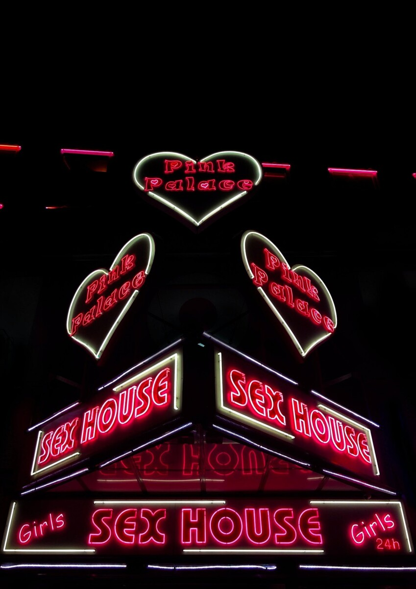

*Red light district Reeperbahn, Hamburg (Germany). Image by Vicky Hladynets.*

Why red light districts? In symbolism, the colour red represents passion and sexuality, but also seduction and evil. The female body has been seen in history and in many religions only in two contexts: as an instrument for bearing children, and as a dangerous instrument to lure men towards evil and sin. On top of this, the unbalanced power relations in society, especially referring to financial resources, affect both men and women, and perpetuate the image of women selling and men buying sex (Schulze et al., 2014). Some experts argue that prostitution in effect reinforces this gender stereotype with men having potentially an unlimited access to women’s bodies, depending on their economic status.

All in all, the debate on prostitution is especially challenging. It involves bias, assumptions, social injustices, discrimination and lack of understanding. As I mentioned in the beginning, prostitution has always been lining the urban fabric. It is time for policy makers, urbanists, architects and designers to finally include sex workers in their drawings, plans and policies, and provide them with safety and independence that they need.

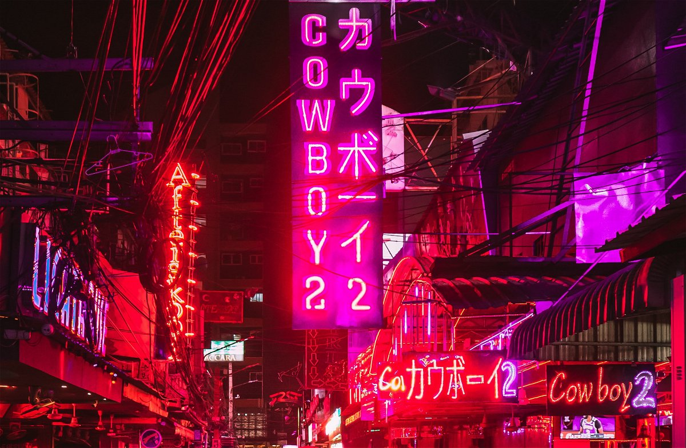

*Soi Cowboy, Bangkok (Thailand). Image (top section) by Pablo Torrado.*

**Bibliography**

Belingar, Bostjan. “How I Had Sex with Amsterdam Prostitute .” Boss Life Hacks, February 2, 2016. https://www.bosslifehacks.com/2016/02/02/how-i-had-sex-with-an-amsterdam-prostitute/.

Cruz, Joshua, and Swaan van Iterson. “The Audacity of Tolerance: A Critical Analysis of Legalized Prostitution in Amsterdam’s Red Light District .” Humanity in Action Nederland. Accessed April 27, 2021. https://www.humanityinaction.org/knowledge_detail/the-audacity-of-tolerance-a-critical-analysis-of-legalized-prostitution-in-amsterdams-red-light-district/.

European Commission. “Data Collection on Trafficking in Human Beings in the EU: Final Report,” 2018. https://doi.org/10.2837/193237.

Schulze, Erika, Sandra Isabel Novo Canto, Peter Mason, and Maria Skalin. “DIRECTORATE GENERAL FOR INTERNAL POLICIES POLICY DEPARTMENT C: CITIZENS’ RIGHTS AND CONSTITUTIONAL AFFAIRS GENDER EQUALITY Sexual Exploitation and Prostitution and Its Impact on Gender Equality STUDY,” 2014.

**Acknowledgements**

This article by Oliwia Jackowska was previously published in Bnieuws 54/05, May 2021.  
[Bnieuws](https://web.archive.org/web/2023/https://www.bnieuws.nl/) is the independent, student-run platform and monthly periodical for the Faculty of Architecture and the Built Environment, Delft University of Technology (Netherlands).

Oliwia Jackowska is a Master student from Poland, completed her undergraduate studies in the UK and is now (July 2021) an Urbanism student in Delft, as well as an editor at Bnieuws.  
[@oliwia.jack](https://www.instagram.com/oliwia.jack/)

This webpage is edited by Favas.net.  
Selected images by Vicky Hladynets, Gio Mikava, Joan Oger, and Pablo Torrado.

This article of Oliwia Jackowska became part of [‘Red Light Realm’ – an ‘umbrella’ project under the responsibility of Favas.net](http://favas.net/projects/red-light-realm/). The aim of this project is a free and unconditional exploration of urban ‘red light’ zones.

---

### Taboo in translation

Feb 2021 · in *Taboo*

Original: <https://www.bnieuws.nl/read/taboo-in-translation>  
Archived copy: <https://web.archive.org/web/20241206135309/https://www.bnieuws.nl/read/taboo-in-translation> (2024-12-06)  
On this site: [archive/taboo-in-translation/](archive/taboo-in-translation/)

Taking advantage of the international and multicultural community of TU Delft, we collected national traditions or beliefs that only make sense in given communities. We might not understand why they exist, but this is what makes it special. Let’s respect each other and enjoy the beautiful mixture of traditions and taboos all around the world! Enjoy.

[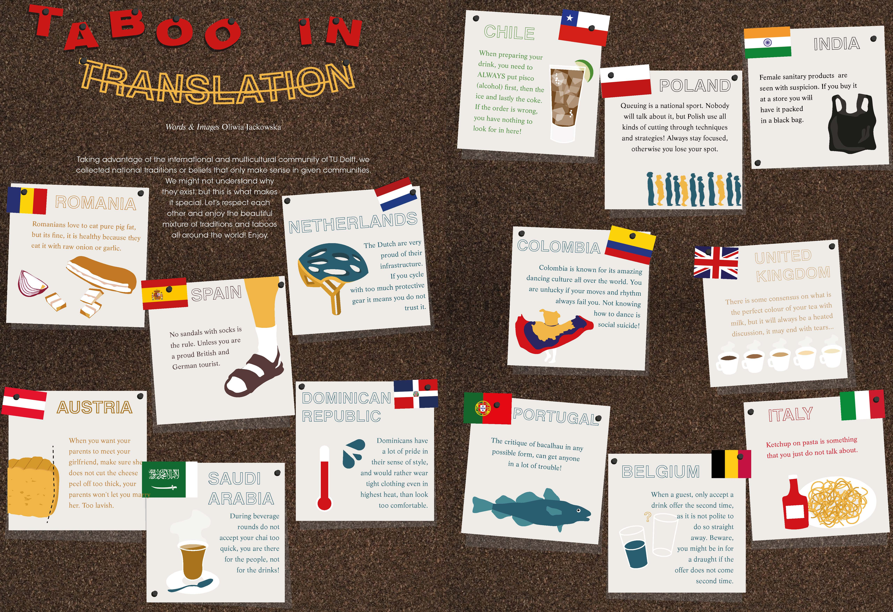](https://web.archive.org/web/2023/https://www.bnieuws.nl/read/taboo-in-translation#)

**Romania**  
Romanians love to eat pure pig fat, but its fine, it is healthy because they eat it with raw onion or garlic.

‍

**Spain**  
No sandals with socks is the rule. Unless you are a proud British and German tourist.

‍

**Austria**  
When you want your parents to meet your girlfriend, make sure she does not cut the cheese peel off too thick, your parents won't let you marry her. Too lavish.

‍

**Saudi Arabia  
‍**During beverage rounds do not accept your chai too quick, you are there for the people, not for the drinks!

‍

**Netherlands**  
The Dutch are very proud of their infrastructure. If you cycle with too much protective gear it means you do not trust it.

‍

**Dominican Republic  
‍**Dominicans have a lot of pride in their sense of style, and would rather wear tight clothing even in highest heat, than look too comfortable.

‍

**Colombia**  
Colombia is known for its amazing dancing culture all over the world. You are unlucky if your moves and rhythm always fail you. Not knowing how to dance is social suicide!

‍

**Portugal**  
The critique of bacalhau in any possible form, can get anyone in a lot of trouble!

‍

**Chile**  
When preparing your drink, you need to ALWAYS put pisco (alcohol) first, then the ice and lastly the coke. If the order is wrong, you have nothing to look for in here!

‍

**Poland  
‍**Queuing is a national sport. Nobody will talk about it, but Polish use all kinds of cutting through techniques and strategies! Always stay focused, otherwise you lose your spot.

‍

**India**  
Female sanitary products are seen with suspicion. If you buy it at a store you will have it packed in a black bag.

‍

**United Kingdom**  
There is some consensus on what is the perfect colour of your tea with milk, but it will always be a heated discussion, it may end with tears...

‍

**Italy**  
Ketchup on pasta is something that you just do not talk about.

‍

**Belgium**  
When a guest, only accept a drink offer the second time, as it is not polite to do so straight away. Beware, you might be in for a draught if the offer does not come second time.

‍

‍

---

### The History of Human-Computer Interaction

Dec 2020 · in *Digital space*

Original: <https://www.bnieuws.nl/read/the-history-of-human-computer-interaction>  
Archived copy: <https://web.archive.org/web/20250218202215/https://www.bnieuws.nl/read/the-history-of-human-computer-interaction> (2025-02-18)  
On this site: [archive/the-history-of-human-computer-interaction/](archive/the-history-of-human-computer-interaction/)

[The Competition is out now!](https://web.archive.org/web/2023/https://www.bnieuws.nl)[*Become a Pen Pal!*](https://web.archive.org/web/2023/https://www.bnieuws.nl/contact#penpals)

!

###### From the editors

###### Oliwia Jackowska

[Return to top ↑](https://web.archive.org/web/2023/https://www.bnieuws.nl/read/the-history-of-human-computer-interaction#top)

[I would rather…](https://web.archive.org/web/2023/https://www.bnieuws.nl/read/i-would-rather)

[Read →](https://web.archive.org/web/2023/https://www.bnieuws.nl/read/i-would-rather)

6

[Space syntax as urban design tool](https://web.archive.org/web/2023/https://www.bnieuws.nl/read/space-syntax-as-urban-design-tool)

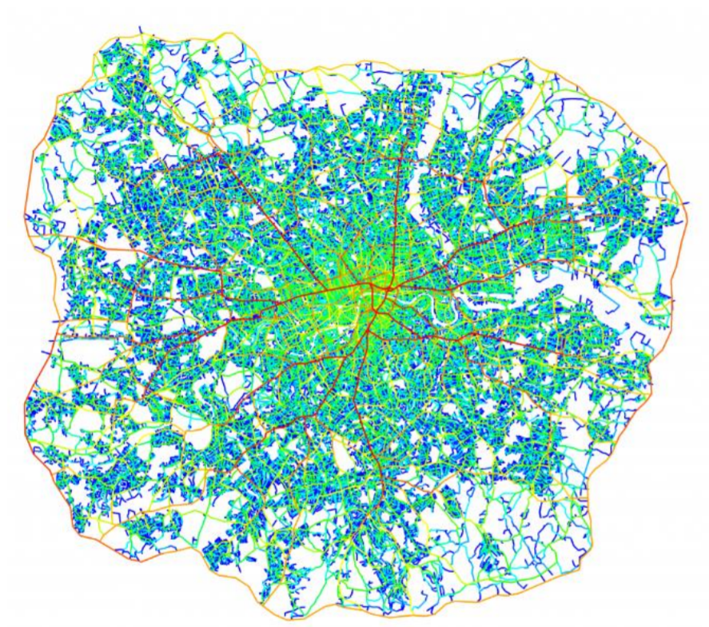

[Read →](https://web.archive.org/web/2023/https://www.bnieuws.nl/read/space-syntax-as-urban-design-tool)

4

[The daily digital life](https://web.archive.org/web/2023/https://www.bnieuws.nl/read/the-daily-digital-life)

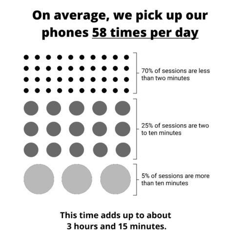

[Read →](https://web.archive.org/web/2023/https://www.bnieuws.nl/read/the-daily-digital-life)

11

---

### The Adolescence and Architecture

Jun 2019

_PDF, not copied: <https://paperspacemagazine.github.io/Website/issues/12%20Childhood.pdf>_

---

### A Union of Architects: Team 10, Modernism and Capitalism

2019

_PDF, not copied: <https://paperspacemagazine.github.io/Website/issues/11%20Union.pdf>_
